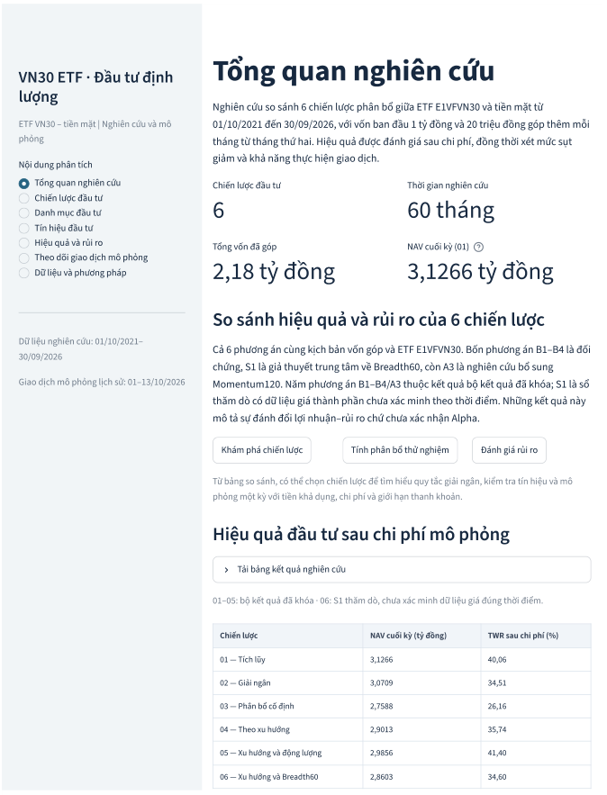
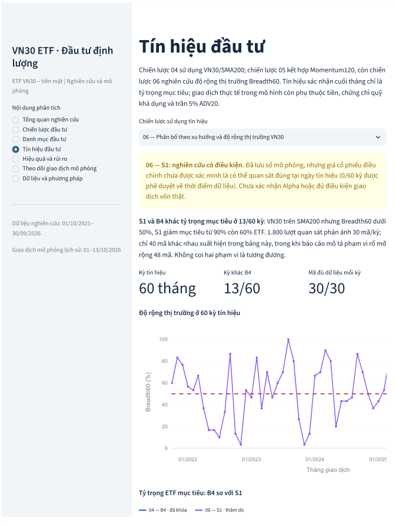
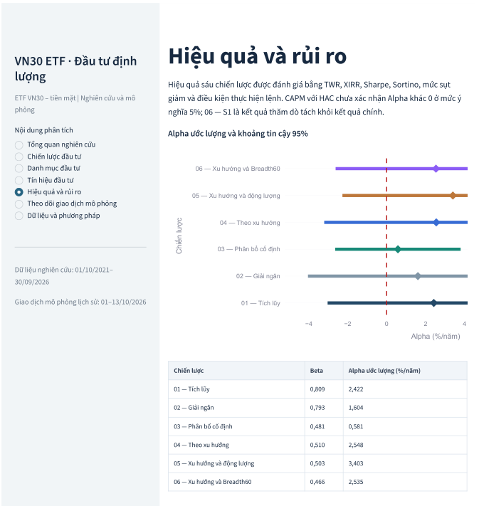

# VN30 ETF | Từ tín hiệu thị trường đến quyết định đầu tư

**Nghiên cứu chiến lược và mô phỏng danh mục ETF VN30**

Một tín hiệu có thể gợi ý khi nào giảm tỷ trọng ETF. Nhưng sau tín hiệu ấy, danh mục thực sự bán được bao nhiêu, còn nắm giữ bao nhiêu và đang chịu rủi ro gì?

Dự án này bắt đầu từ khoảng cách giữa **một chiến lược có kết quả Backtest** và **một quyết định đầu tư có thể thực hiện, theo dõi và kiểm chứng**. Trên cùng dữ liệu lịch sử, tôi nghiên cứu các chính sách giải ngân và phân bổ ETF VN30, sau đó nối tín hiệu với dòng tiền, số chứng chỉ quỹ, giới hạn thanh khoản, chi phí, giá trị tài sản và rủi ro danh mục.

**[Trải nghiệm VN30 ETF Quant Platform](https://vn30-etf-quant-platform.onrender.com/)** · [Một tình huống giao dịch đáng chú ý](TINH_HUONG_SU_DUNG.md) · [Ví dụ Python](examples/accounting_example.py)

Đây là công trình nghiên cứu cá nhân, không phải sản phẩm đã được TVS nghiệm thu hoặc khuyến nghị đầu tư. Ứng dụng phục vụ nghiên cứu và mô phỏng, không kết nối đặt lệnh bằng tiền thật. Máy chủ thử nghiệm có thể cần thêm thời gian khởi động sau một thời gian không hoạt động.

## Bài toán nghiên cứu

Giả sử nhà đầu tư có **1 tỷ đồng ban đầu**, góp thêm **20 triệu đồng mỗi tháng trong 59 tháng**. Có nên đầu tư ngay toàn bộ, chia vốn thành nhiều đợt, duy trì một tỷ trọng ETF cố định hay điều chỉnh theo thị trường?

Tôi xây dựng sáu phương án trên giai đoạn **01/10/2021–30/09/2026**, gồm **1.245 phiên giao dịch** và **2,18 tỷ đồng tổng vốn góp**. Năm phương án B1–B4/A3 thuộc nghiên cứu chính; S1 là nhánh khảo sát bổ sung với giới hạn dữ liệu riêng.

| Phương án | Cách phân bổ | Câu hỏi nghiên cứu |
|:--|:--|:--|
| **B1** | Tích lũy ETF định kỳ | Đầu tư sớm và góp đều mang lại kết quả gì? |
| **B2** | Giải ngân vốn ban đầu thành sáu đợt | Chia thời điểm mua giúp thay đổi rủi ro ra sao? |
| **B3** | Duy trì ETF/tiền mặt ở mức 60/40 | Tỷ trọng cố định tạo ra sự đánh đổi nào? |
| **B4** | VN30/SMA200; tỷ trọng ETF mục tiêu 30% hoặc 90% | Phân bổ theo xu hướng có giảm sụt giảm không? |
| **A3** | SMA200 và Momentum120; mục tiêu 30/60/90% | Bổ sung động lượng làm thay đổi kết quả thế nào? |
| **S1** | SMA200 và Breadth60; mục tiêu 30/60/90% | Độ rộng thị trường có bổ sung thông tin hữu ích không? |

Với S1, dữ liệu giá điều chỉnh của các cổ phiếu thành phần chưa được xác minh đầy đủ về khả năng quan sát đúng tại thời điểm phát sinh tín hiệu. Vì vậy, kết quả S1 được trình bày riêng như **nghiên cứu thăm dò**.

## Khi nghiên cứu trở thành một quy trình đầu tư

Ứng dụng gồm bảy mục Streamlit, phục vụ ba công việc thường gặp trong nghiên cứu chiến lược, phân tích đầu tư và theo dõi rủi ro danh mục:

| Vấn đề cần giải quyết | Cách ứng dụng hỗ trợ | Kết quả có thể kiểm tra |
|:--|:--|:--|
| **Lựa chọn chính sách giải ngân** | So sánh NAV, XIRR, mức sụt giảm và lọc theo ngưỡng chịu lỗ | Những phương án phù hợp mức rủi ro đã chọn trong dữ liệu lịch sử |
| **Chuyển tín hiệu thành quyết định phân bổ** | Truy nguyên SMA200/Momentum120, tỷ trọng mục tiêu và mô phỏng một kỳ với vốn, tiền mặt, số CCQ hiện có | Nhu cầu mua/bán, chi phí, lượng thực hiện giả định và tỷ trọng sau giao dịch |
| **Kiểm tra rủi ro khi thực hiện lệnh** | Đối chiếu tín hiệu, sổ lệnh, giới hạn 5% ADV20 và trạng thái tài khoản | Phần lệnh chưa thực hiện, tiền chờ thanh toán và mức lệch so với mục tiêu |

Điểm hữu ích của cách tiếp cận này nằm ở **mối liên hệ giữa các bước**: từ giả thuyết và tín hiệu đến giao dịch, kế toán tài sản và rủi ro còn lại. Thay vì xem những bảng tính rời nhau, người nghiên cứu có thể lần theo cùng một quyết định qua dữ liệu và sổ mô phỏng.

### Một lệnh bán không thực hiện được như dự kiến

Ngày **01/10/2026**, phương án B4 đặt mục tiêu đưa tỷ trọng ETF về **30%**. Sổ mô phỏng ghi nhận đề nghị bán **37.700 CCQ**, nhưng chỉ **25.600 CCQ** được thực hiện giả định theo giới hạn thanh khoản và lô giao dịch. **12.100 CCQ** còn lại không thực hiện.

Đến **13/10/2026**, tỷ trọng ETF của tài khoản vẫn ở mức **43,62%**. Đây là trạng thái tại ngày 13/10, không phải tỷ trọng ngay sau lệnh ngày 01/10; biến động giá, dòng tiền và các phiên tiếp theo cũng ảnh hưởng đến khoảng cách so với mục tiêu.

Một tín hiệu đúng quy tắc, vì thế, chưa đủ bảo đảm danh mục đạt tỷ trọng mong muốn. Tình huống này minh họa vì sao công cụ đầu tư cần theo dõi cả **khả năng thực hiện lệnh và trạng thái tài sản**, không chỉ điểm mua/bán.

[**Xem toàn bộ tình huống và cách đối chiếu trên ứng dụng**](TINH_HUONG_SU_DUNG.md).

## Kết quả nghiên cứu lịch sử

| Phương án | NAV cuối kỳ (tỷ đồng) | TWR (%) | XIRR (%/năm) | MDD (%) |
|:--|--:|--:|--:|--:|
| B1 | 3,1266 | 40,06 | 10,06 | −42,27 |
| B2 | 3,0709 | 34,51 | 9,55 | −42,00 |
| B3 | 2,7588 | 26,16 | 6,53 | −26,81 |
| B4 | 2,9013 | 35,74 | 7,94 | −20,39 |
| A3 | 2,9856 | 41,40 | 8,75 | −18,91 |
| S1* | 2,8603 | 34,60 | 7,54 | −17,62 |

*B1–B4/A3: kết quả R01 đã đối soát. S1: sổ nghiên cứu bổ sung, chưa hoàn tất kiểm chứng dữ liệu đúng thời điểm. Số liệu theo Phụ lục A của báo cáo sáu chiến lược ngày 15/10/2026. NAV bao gồm vốn đã góp; TWR tách ảnh hưởng của dòng vốn bổ sung, XIRR phản ánh thời điểm góp vốn, còn MDD đo mức sụt giảm từ đỉnh xuống đáy.*

Trong mẫu lịch sử, **B1 có NAV và XIRR cao nhất**, đồng thời chịu mức sụt giảm khoảng **42%**. B4 và A3 giảm sụt giảm so với B1, nhưng cũng duy trì tỷ trọng ETF bình quân thấp hơn. Phần chênh lệch hiệu quả cần được nhìn nhận cùng mức độ tiếp xúc thị trường, thay vì quy toàn bộ cho khả năng dự báo của tín hiệu.

Các ước lượng **Alpha chưa đạt ý nghĩa thống kê ở mức 5%** theo mô hình CAPM với sai số chuẩn HAC. Đây là kết quả nghiên cứu về sự đánh đổi giữa hiệu quả và rủi ro, chưa phải bằng chứng về khả năng tạo lợi nhuận vượt trội bền vững.

**Phương án tiếp tục kiểm chứng:** A3 được chọn làm ứng viên theo dõi trên dữ liệu mới, với B4 là đối chứng trực tiếp để đánh giá đóng góp của Momentum120 và B1 là mốc tích lũy dài hạn. S1 tiếp tục xác minh dữ liệu Breadth60. Đây là quyết định nghiên cứu có điều kiện; hiện chưa có bằng chứng tiến cứu đủ mạnh hoặc phê duyệt sử dụng vốn thật.

## Vì sao chọn E1VFVN30?

Để so sánh các chính sách phân bổ trên cùng một cơ sở, nghiên cứu sử dụng **E1VFVN30 làm ETF giao dịch mô phỏng**. Quỹ có lịch sử giao dịch dài và chuỗi giá tương đối liên tục, thuận tiện cho việc theo dõi danh mục trong giai đoạn nghiên cứu. Thanh khoản cũng là một tiêu chí quan trọng vì một chiến lược chỉ có ý nghĩa thực tế khi lượng giao dịch giả định có cơ sở thực hiện.

| ETF theo dõi VN30 | Bắt đầu giao dịch | Phí quản lý (%/năm) | Trung vị khớp lệnh (tỷ đồng/phiên) |
|:--|:--:|--:|--:|
| **E1VFVN30 – DCVFMVN30** | 06/10/2014 | 0,65 | **14,351** |
| FUESSV30 – SSIAM VN30 | 18/08/2020 | 0,55 | 0,444 |
| FUEMAV30 – MAFM VN30 | 08/12/2020 | 0,60 | 0,239 |
| FUEKIV30 – KIM Growth VN30 | 07/01/2022 | 0,55 | 0,060 |

*Nguồn: Bảng 1, báo cáo nghiên cứu ngày 15/10/2026; giá trị khớp lệnh trung vị trên 182 phiên từ 05/01 đến 30/09/2026. Các số liệu này phục vụ đối chiếu khi lập báo cáo, không phản ánh tập thông tin sẵn có ở thời điểm đầu mẫu năm 2021.*

Tại phiên tham chiếu **17/09/2021**, giá trị khớp lệnh lần lượt khoảng **22,08 tỷ đồng** với E1VFVN30, **2,07 tỷ đồng** với FUEMAV30 và **0,70 tỷ đồng** với FUESSV30. FUEKIV30 chưa giao dịch vào thời điểm đó. Những quan sát này hỗ trợ việc lựa chọn tài sản nghiên cứu, nhưng chưa đủ để kết luận E1VFVN30 là phương án tốt nhất về hiệu quả đầu tư hoặc tổng chi phí.

Một khác biệt phương pháp cũng được giữ rõ: theo hồ sơ quỹ dẫn trong báo cáo, E1VFVN30 tham chiếu **VN30 Total Return Index**, trong khi tín hiệu và CAPM của nghiên cứu sử dụng **VN30 Price Index**. Việc chưa đồng nhất chuẩn so sánh là một giới hạn khi diễn giải Alpha và mức độ bám chỉ số.

## Khám phá ứng dụng

<details>
<summary><strong>Ba hành trình có thể tự trải nghiệm</strong></summary>

- **Từ mục tiêu đầu tư đến chính sách phù hợp:** tại *Tổng quan nghiên cứu*, lựa chọn ngưỡng sụt giảm, đối chiếu XIRR và NAV lịch sử giữa các phương án.
- **Từ tín hiệu đến giao dịch:** tại *Chiến lược đầu tư* và *Tín hiệu đầu tư*, xem mốc xác nhận tín hiệu, tỷ trọng mục tiêu và mô phỏng phân bổ với điều kiện tài khoản cụ thể.
- **Từ giao dịch đến rủi ro còn lại:** tại *Danh mục đầu tư*, *Hiệu quả và rủi ro* và *Theo dõi giao dịch mô phỏng*, đối chiếu tỷ trọng thực tế, mức sụt giảm, giới hạn lệnh và trạng thái thanh toán.

</details>

| So sánh chính sách | Truy nguyên tín hiệu | Kiểm định và rủi ro |
|:--:|:--:|:--:|
|  |  |  |

*Ảnh chụp ứng dụng lúc 09:19–09:21 ngày 15/10/2026, trước lượt chỉnh sửa giao diện cuối. Giao diện trực tuyến có thể khác đôi chút.*

## Phương pháp và giới hạn sử dụng

Mô hình giao dịch ETF–tiền mặt sử dụng **phí 0,15% mỗi chiều**, **trượt giá 0,05% mỗi chiều**, **thuế bán 0,10%**, **lô 100 CCQ**, **giới hạn 5% ADV20** và **lãi tiền mặt 0%**. Lệnh giả định tuân theo thời điểm xác nhận tín hiệu và quy tắc thanh toán của từng giai đoạn. Mô hình chưa phản ánh đầy đủ độ sâu sổ lệnh, cạnh tranh khớp lệnh và sai khác giữa giá mô phỏng với giá thực hiện.

Chín phiên từ **01–13/10/2026** được **tái dựng sau khi thị trường diễn biến** để kiểm tra tài khoản và giao dịch; đây không phải Paper Trading tiến cứu độc lập. S1 vẫn cần xác minh dữ liệu đúng thời điểm, còn năm chiến lược chính chưa có bằng chứng ngoài mẫu/tiến cứu đủ mạnh để chấp thuận giao dịch vốn thật.

Ứng dụng hiện có thể truy cập trực tuyến, song khả năng vận hành máy chủ không tự chứng minh hiệu quả chiến lược hay mức độ sẵn sàng phục vụ nhà đầu tư. Giá trị sử dụng thường xuyên, mức tiết kiệm thời gian so với cách làm khác và tiềm năng thương mại hóa vẫn cần được đánh giá với người dùng thực tế.

## Ví dụ mã nguồn

Thư mục [`examples/`](examples/) giới thiệu những đoạn Python độc lập về kiểm tra NAV và giới hạn khối lượng lệnh, kèm phép thử tương ứng. Đây là các ví dụ minh họa cách xử lý một bài toán tài chính, **không phải mã nguồn của bộ máy Backtest hay Paper Trading**. Có thể chạy phép thử bằng:

```bash
python -m unittest discover -s examples -p 'test_*.py'
```

Mã nguồn hệ thống, các chương trình nghiên cứu, dữ liệu gốc và sổ mô phỏng được lưu riêng để phục vụ kiểm chứng và phát triển lâu dài. Kho hồ sơ này chỉ gồm những nội dung đã chọn để giới thiệu công trình. **Chưa áp dụng giấy phép mã nguồn mở.**
